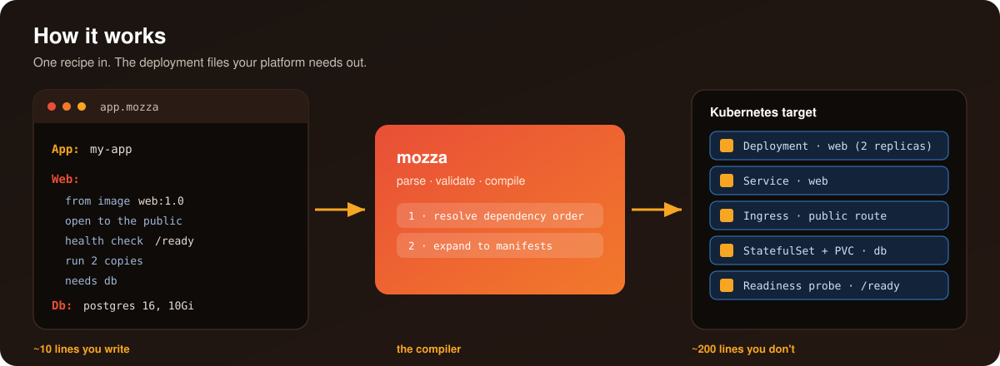

<div align="center">


[](https://go.dev)
[](https://github.com/gshepptech/mozza/releases)
[](https://github.com/gshepptech/mozza/releases)
[](LICENSE)

**A deployment compiler. Write ~10 lines of plain English — pick up the file, or get it delivered.**

[Quick Start](#-quick-start) · [Two Paths](#-two-paths) · [How It Works](#-how-it-works) · [CLI](#cli-reference) · [Config](#️-configuration) · [Contributing](CONTRIBUTING.md)

</div>

> Mozza is a compiler for deployment formats. You describe your app once, in plain language —
> `open to the public on port 3000`, `run 2 copies`, `needs db` — and Mozza either **hands you the
> file** your platform needs, or **deploys it for you**. Same recipe, different backend. The
> `.mozza` recipe is the source; the 200 lines of YAML are a build artifact.

Deploying apps as easy as ordering a pizza. You get it delivered, or you pick it up.

---

## 🍕 Two Paths

Both paths run the same compiler. Pick whichever fits.

### 🥡 Pick it up — you get the file

For engineers who already have a platform, a pipeline, and opinions.

```bash
mozza compile --target kubernetes -o ./deploy
```

You get real files on disk. Commit them, PR them, let your existing CI apply them. Mozza never
touches your cluster, never asks for credentials, never runs as a service. It's a compiler you
invoke, like `tsc` or `gcc` — **offline, no login, no server.**

### 🛵 Get it delivered — Mozza deploys it

For anyone who doesn't want a file at all.

```bash
mozza up          # locally, via Docker Compose
mozza deploy      # to your Kubernetes cluster
mozza serve       # or use the dashboard: pick an app, answer three questions, place the order
```

Mozza compiles, applies, watches it come up, and hands you a working URL.

---

## ✨ Features

| Feature | What you get |
|---|---|
| 🧾 **Recipe DSL** | Describe your stack in ~10 lines instead of 200 lines of YAML |
| 🎯 **Multiple compile targets** | `mozza compile --target kubernetes` or `--target local` — one recipe, different output |
| 📴 **Offline compile** | `mozza compile` needs no cluster, no config file, and no login |
| 🪄 **Guided deploy wizard** | Answer plain-English questions in the web UI, get a working recipe |
| 🗃️ **Template catalog** | 15 pre-built apps (WordPress, Ghost, Gitea, Grafana, and more) to deploy in one click |
| ↩️ **Rollback** | Revert to a previous deployment with `mozza rollback` |
| 🚦 **Environment promotion** | Move deployments from staging to production with `mozza promote` |
| 🩺 **Health checks** | `mozza doctor` diagnoses your environment and tells you what to fix |
| 🐙 **GitHub import** | Point Mozza at a repo and it infers a recipe from the codebase |
| 📊 **Web dashboard** | 20-page UI for deploys, monitoring, recipes, clusters, and teams |

---

## 🚀 Quick Start

```bash
# Install
go install github.com/gshepptech/mozza/cmd/mozza@latest

# Create a project
mozza init my-app
```

Then pick a path.

**Pick it up** — no cluster, no Docker, no config required:

```bash
mozza targets                              # see what you can compile to
mozza compile --target local -o ./out      # writes ./out/docker-compose.yml
```

**Get it delivered** — needs Docker (local) or a cluster (Kubernetes):

```bash
mozza up          # start it locally
```

### Before → After

Mozza turns this 👇

```yaml
# kubernetes deployment (abbreviated -- the real thing is longer)
apiVersion: apps/v1
kind: Deployment
metadata:
  name: web
spec:
  replicas: 2
  selector:
    matchLabels:
      app: web
  template:
    metadata:
      labels:
        app: web
    spec:
      containers:
      - name: web
        image: myorg/web:1.0.0
        ports:
        - containerPort: 3000
        readinessProbe:
          httpGet:
            path: /ready
            port: 3000
---
apiVersion: v1
kind: Service
metadata:
  name: web
spec:
  selector:
    app: web
  ports:
  - port: 3000
```

…into this 👇

```
App: my-app

Web:
  from image myorg/web:1.0.0
  open to the public on port 3000
  health check /ready
  run 2 copies
  needs db

Db:
  postgres 16, 10Gi
```

Same result. You describe what you want; Mozza figures out the infrastructure.

---

## 📦 Install

| Method | Command |
|---|---|
| 🚀 **Go install** | `go install github.com/gshepptech/mozza/cmd/mozza@latest` |
| 🐳 **Docker** | Build the included image: `docker build -t mozza .` then `docker run -p 8080:8080 -v mozza-data:/data mozza` |
| 📥 **Binaries** | Download from [GitHub Releases](https://github.com/gshepptech/mozza/releases) (linux & macOS, amd64 & arm64) |
| 🛠️ **From source** | `git clone https://github.com/gshepptech/mozza.git && cd mozza && go build -o mozza ./cmd/mozza` |

The Docker image's entrypoint is `mozza serve` — it runs the dashboard, not the compiler.

---

## 🧩 How It Works

<div align="center">



</div>

Mozza reads a `.mozza` recipe file that describes your application in plain
language. Each block (called a **slice**) defines one service — a web frontend,
an API, a database, a cache, a worker.

The compiler has one frontend and several backends:

```
                    ┌──────────────────┐
   app.mozza  ───▶  │  recipe → plan   │  ──▶  Kubernetes manifests   (--target kubernetes)
   (plain English)  │   (the compiler) │  ──▶  Docker Compose         (--target local)
                    └──────────────────┘  ──▶  Helm, Nomad, …         (planned)
```

`mozza compile` stops at the arrow — you get files. `mozza up` and `mozza deploy` keep going and
apply them.

When you run `mozza up` or `mozza deploy`, Mozza:

1. **Parses** the recipe and validates dependencies between slices
2. **Compiles** to the chosen target (Docker Compose locally, Kubernetes manifests for production)
3. **Deploys** everything in dependency order — databases before backends, backends before frontends
4. **Monitors** health checks and reports status

Kubernetes is the reference semantics for the recipe language, and it is the default target. Other
targets are honest projections from it — when a target can't express something, Mozza reports it as
a warning rather than dropping it quietly.

### Compiling without a cluster

```console
$ mozza targets
  TARGET      DESCRIPTION
* kubernetes  Kubernetes manifests (Deployment, Service, Ingress, PVC, RBAC, ...)
  local       Docker Compose file for running on one machine

* default target, used when --target is omitted

$ mozza compile --target local -o ./out
  wrote out/docker-compose.yml
Generated docker-compose.yml for "my-app" with 2 service(s), 1 volume(s), 1 network(s).

$ mozza compile -o ./deploy
  wrote deploy/k8s/web-deployment.yaml
  wrote deploy/k8s/db-statefulset.yaml
  wrote deploy/k8s/web-service.yaml
  wrote deploy/k8s/db-service.yaml
  wrote deploy/k8s/web-ingress.yaml
generated 5 Kubernetes manifests for "my-app"
```

The `kubernetes` target nests its manifests in a `k8s/` subdirectory of the output directory; the
`local` target writes `docker-compose.yml` at the top of it.

Nothing above contacted a cluster, read a kubeconfig, or wrote deployment state.

When a target can't express something, it says so instead of dropping it. A recipe asking for
`scale between 2 and 8 copies based on cpu 75%` compiles to a HorizontalPodAutoscaler on
Kubernetes; on the local target you get:

```console
$ mozza compile --target local -o ./out
  wrote out/docker-compose.yml
Generated docker-compose.yml for "my-app" with 1 service(s), 1 network(s).

1 warning(s):
  ! web: Auto-scaling is Kubernetes-only. Running a fixed replica count locally.
```

Warnings don't fail the build, so read them — silence is the signal that nothing was lost.

### A fuller recipe

```
App: full-stack
Namespace: production

Frontend:
  from image myorg/frontend:2.4.1
  open to the public on port 3000
  health check /ready
  run 3 copies
  domain "shop.example.com"
  needs backend

Backend:
  from image myorg/backend:1.8.0
  on port 8080
  health check /healthz
  run 4 copies
  set DATABASE_URL to "postgres://db:5432/app"
  limit cpu to "500m"
  limit memory to "512Mi"
  needs db and cache

Worker:
  from image myorg/worker:1.8.0
  run 2 copies
  needs db and cache

Db:
  postgres 16, 50Gi

Cache:
  redis 7, 1Gi
```

Each block is a slice. Lines starting with `#` are comments. Use `needs` to
declare dependencies between slices.

### The web dashboard

Run `mozza serve` and open <http://localhost:8080>. The dashboard gives you:

- A **guided wizard** that asks plain-English questions and generates a recipe
- **Deploy tracking** with status, timestamps, and logs
- A **template catalog** with 15 ready-to-deploy apps (WordPress, Ghost, Gitea, and more)
- Live **application status** with health checks and resource usage

Both paths are available over HTTP too: `GET /api/v1/targets` lists the compile targets, and
`POST /api/v1/compile` compiles a recipe and returns the files without applying anything. Both
require a session cookie; neither requires the `deployer` or `admin` role.

### CLI reference

**Compile — pick it up**

| Command | What it does |
|---|---|
| `mozza targets` | List available compile targets |
| `mozza compile [--target <t>] [-o <dir>]` | Compile the recipe to artifacts on disk. Default target `kubernetes`, default output `.` |

**Deploy — get it delivered**

| Command | What it does |
|---|---|
| `mozza up` | Start the app locally (Docker Compose) |
| `mozza down` | Stop and remove the app |
| `mozza deploy` | Deploy to Kubernetes |
| `mozza rollback` | Roll back to a previous deployment |
| `mozza promote` | Promote a deployment to the next environment |
| `mozza operator` | Run the deployment operator |
| `mozza serve` | Start the web dashboard |

**Stacks — whole local environments for apps that ship their own charts** ([docs/stacks.md](docs/stacks.md))

| Command | What it does |
|---|---|
| `mozza stack init [dir]` | Draft `mozza-stack.yaml` from a repo's chart, Dockerfiles and values |
| `mozza stack list` | List the stacks and addons Mozza knows |
| `mozza stack plan <stack>` | Print every command `up` would run, running none |
| `mozza stack up <stack>` | Create a local kind/k3d cluster, build and load images, install addons and charts |
| `mozza stack forward <stack>` | Forward the stack's services to 127.0.0.1 until Ctrl-C |
| `mozza stack secrets <stack>` | Print the credentials a stack marks for people |
| `mozza stack status <stack>` | Show nodes, Helm releases and pods |
| `mozza stack down <stack>` | Delete the cluster, if `up` created it |

**Author and inspect**

| Command | What it does |
|---|---|
| `mozza init [app-name]` | Scaffold a new project |
| `mozza validate` | Check the recipe file for errors |
| `mozza status [slice]` | Show what is running |
| `mozza logs [slice]` | View logs |
| `mozza doctor` | Diagnose your environment |
| `mozza import <file>` | Turn a Docker Compose file into a recipe |
| `mozza version` | Print the version |

**Marketplace, Git, and proxy**

| Command | What it does |
|---|---|
| `mozza recipe search [query]` | Search recipes by name, category, or tags |
| `mozza recipe info <name>` | Show detailed recipe information |
| `mozza recipe install <name>` | Download a catalog recipe |
| `mozza recipe deploy <name>` | Download and deploy a recipe directly |
| `mozza recipe update` | Refresh the recipe index |
| `mozza connect <repo_url>` | Connect a GitHub repo for push-to-deploy |
| `mozza disconnect` | Disconnect all GitHub repositories |
| `mozza previews list` · `previews clean` | Manage branch preview deployments |
| `mozza proxy status` | Show the reverse-proxy routing table |

> **Deprecated:** `mozza deploy --export` still works but prints a deprecation notice. Use
> `mozza compile --target kubernetes` instead.

---

## 🗂️ Project Layout

| Path | What lives there |
|---|---|
| `cmd/mozza/` | CLI entrypoint (Cobra) |
| `internal/recipe/` · `internal/plan/` | Recipe parser and the target-independent plan it builds |
| `internal/compile/` · `internal/targets/` | Compiler interface, and the registry of built-in targets |
| `internal/k8s/` · `internal/local/` | The compiler backends — Kubernetes manifests and Docker Compose |
| `internal/deploy/` | Deploy pipeline (image pre-validation, apply, readiness, auto-rollback) |
| `internal/server/` · `internal/ui/` | HTTP API and embedded web UI |
| `internal/store/` · `internal/state/` | SQLite-backed state |
| `internal/importer/` · `internal/detect/` | GitHub / Compose / Dockerfile / Helm import & framework detection |
| `internal/monitor/` · `internal/doctor/` | Health monitoring and environment diagnostics |
| `ui/` | React + Vite dashboard (20 pages) |
| `examples/` | Sample `.mozza` recipes |
| `docs/` | [Vision](docs/VISION.md), [getting started](docs/getting-started.md), and [production guide](docs/production-guide.md) |

---

## ⚙️ Configuration

Mozza reads from `.mozza.yaml`, environment variables (`MOZZA_` prefix), or
built-in defaults. Config files are searched in the current directory and
`$HOME/.mozza/`. `mozza compile` and `mozza targets` work fine with no config file at all.

| Variable | Config Key | Default | Description |
|----------|------------|---------|-------------|
| `MOZZA_LOG_LEVEL` | `log_level` | `info` | debug, info, warn, error |
| `MOZZA_RECIPE_FILE` | `recipe_file` | `app.mozza` | Recipe file path |
| `MOZZA_SERVER_HOST` | `server.host` | `localhost` | Dashboard bind address |
| `MOZZA_SERVER_PORT` | `server.port` | `8080` | Dashboard port |
| `MOZZA_DATABASE_PATH` | `database.path` | `mozza.db` | SQLite database path |
| `MOZZA_DOCKER_HOST` | `docker.host` | `unix:///var/run/docker.sock` | Docker daemon socket |
| `MOZZA_DOCKER_NETWORK` | `docker.network` | `mozza` | Docker network for local deploys |

---

## 🧪 Development

```bash
make build     # Compile to bin/mozza
make test      # Run tests with the race detector
make lint      # Run golangci-lint
make check     # Lint + test + security checks
make clean     # Remove build artifacts
```

Requires **Go 1.25+**, **golangci-lint**, **Node.js 20+** (for the UI), and
**Docker** (for local testing). The React UI in `ui/` is built and embedded
into the Go binary via `go:embed`.

See [CONTRIBUTING.md](CONTRIBUTING.md) for the full development workflow and PR
process, [CHANGELOG.md](CHANGELOG.md) for release history, and
[SECURITY.md](SECURITY.md) to report vulnerabilities. This project follows the
[Contributor Covenant](CODE_OF_CONDUCT.md).

---

## 🗺️ Roadmap

Today Mozza compiles to two targets: `kubernetes` and `local` (Docker Compose). The compiler
architecture is built for more — Helm and Nomad backends are next, along with a published
capability matrix so you can see exactly what each target can and cannot express before you
compile. See [docs/VISION.md](docs/VISION.md) and
[docs/specs/multi-target-compiler.md](docs/specs/multi-target-compiler.md).

How Mozza compares to other self-hosting tools, honestly:

| | Mozza | Coolify | Dokku | Render | Railway |
|---|---|---|---|---|---|
| Self-hosted | ✅ | ✅ | ✅ | ❌ | ❌ |
| Recipe DSL | ✅ | ❌ | ❌ | ❌ | ❌ |
| Compiles to files you keep | ✅ | ❌ | ❌ | ❌ | ❌ |
| Web dashboard | ✅ | ✅ | ❌ | ✅ | ✅ |
| Kubernetes support | ✅ | ❌ | ❌ | Managed | ❌ |
| Local dev mode | ✅ | ❌ | ✅ | ❌ | ❌ |
| Template catalog | ✅ | ✅ | Plugins | ✅ | ✅ |
| GitHub import | ✅ | ✅ | ✅ | ✅ | ✅ |

**Mozza is for you when** you want one plain-English description of your app that compiles to
whatever your platform speaks — whether you hand the output to your own pipeline or let Mozza
deploy it.

**It is not for you when** you need a fully managed, zero-ops platform, or you need multi-cloud
orchestration. If you are already fluent in Kubernetes, try `mozza compile` — it emits standard
files and stays out of your cluster.

Mozza is **not a lock-in**: it emits standard files that keep working if you delete Mozza.

---

## 📄 License

Apache-2.0 — see [LICENSE](LICENSE). © 2026 gshepptech.
